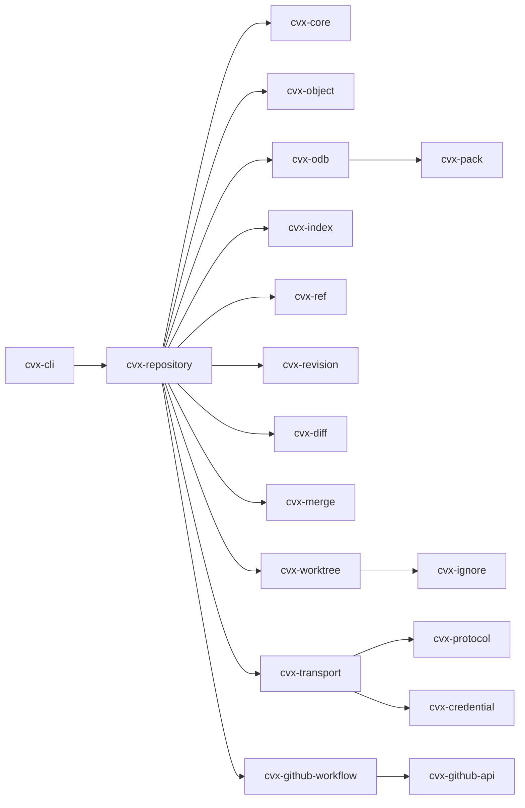

# CVX 🦀

**Own your history. Connect your code.**

[](https://github.com/marcosgabrielgomes110-collab/cvx/actions/workflows/ci.yml)
[](#license)
[](https://www.rust-lang.org/)
[](https://marcosgabrielgomes110-collab.github.io/cvx/)

CVX (Code Version eXchange) is a Git-compatible version control system written
in Rust. It reads and writes the Git repository format, so existing history and
tooling keep working, but the engine does not shell out to the `git` executable.

> **Status: 0.9.4 release.** The local core, history editing, maintenance,
> merge, HTTPS/SSH transport, GitHub workflows, bare repositories, file-backed
> pack reads and thin-pack ingestion are implemented. This includes delta
> packs, SHA-256 protocol negotiation, property-based fuzzing, crash failpoints,
> benchmarks, `.gitattributes`/CRLF and local SHA-256 repositories. GPG release
> signing is supported when configured.
>
> CVX can commit and push this repository directly; Git remains the current
> control directory and the compatibility test oracle.

## What works today

```console
$ cvx init
$ cvx add .
$ cvx commit -m "feat: first commit"
$ cvx status
$ cvx log --oneline
$ cvx diff
$ cvx restore --staged file.rs
$ cvx checkout -- file.rs
$ cvx branch feature/auth
$ cvx switch feature/auth
$ cvx merge main
$ cvx tag -a v1.0.0 -m "first release"
$ cvx log --oneline --decorate
$ cvx clone ../other checkout
$ cvx fetch origin
$ cvx push origin main
```

Local paths, `file://`, `https://`, `ssh://` and SCP-like URLs are supported.
Store a token without putting it in the URL or repository:

```console
$ printf '%s\n' "$GITHUB_TOKEN" | cvx credential store github.com
$ cvx clone https://github.com/owner/private-repo.git
$ cvx fetch origin
$ cvx push origin main

$ cvx clone git@github.com:owner/private-repo.git
$ cvx clone --depth 1 https://github.com/owner/large-repo.git
$ cvx clone --filter=blob:none https://github.com/owner/large-repo.git
```

OAuth device flow and GitHub collaboration workflows:

```console
$ CVX_GITHUB_CLIENT_ID=... cvx github login --oauth --scope repo --scope workflow
$ cvx github scopes --require repo
$ cvx github collaborator list
$ cvx github milestone create "v1.0" --due-on 2027-01-31
$ cvx github issue create "Crash on merge" --assignee alice --milestone 1
$ cvx github pr threads 42
$ cvx github pr resolve <thread-id>
$ cvx github checks required --branch main
$ cvx github graphql --query 'query { viewer { login } }'
$ cvx github release upload v1.0.0 target/release/cvx --label linux-x64
```

SSH uses the system OpenSSH client, so keys and `ssh-agent` work as usual.
`CVX_SSH_KEY` adds an explicit identity file. Credentials prefer the OS
keychain and fall back to a user-only `0600` file when no keychain is available.

Implemented:

- Git-compatible `.cvx/` storage and direct `.git/` compatibility mode;
- loose objects and packfile reads, including delta chains;
- index versions 2 through 4 on input;
- refs, packed refs, detached HEAD and reflogs;
- `init`, `add`, `commit`, `status`, `log`, `diff`, `restore`, `checkout`,
  `branch`, `switch`, `merge` and `tag`;
- three-way merges, conflict markers, index stages 1/2/3 and merge commits with
  two parents;
- `merge --abort` and `merge --continue`;
- annotated and lightweight tags, plus `log --decorate`;
- rename detection in `status` and `diff`;
- pack writing, pack ingestion and readable/writable pack indexes;
- object enumeration and commit/tree/tag reachability;
- `clone`, `fetch`, `push` and remotes over local paths, `file://`, `https://`
  and `ssh://`/SCP-like URLs;
- protocol v2 upload-pack, `ls-refs`/`fetch`, and receive-pack push;
- HTTPS basic authentication with tokens;
- SSH through the system OpenSSH client with key, `ssh-agent` and
  `CVX_SSH_KEY` support;
- OS keychain credential backend with a user-only `0600` file fallback;
- Git credential-helper `fill`, `approve` and `reject` operations;
- shallow clones (`--depth`) and partial clones (`--filter=blob:none` with
  lazy blob fetch);
- GitHub token and OAuth device-flow login, status, logout and scope
  inspection;
- repository create/delete/show, collaborator and permission management;
- issue create/list/close, assignees and milestones;
- pull request create/list/review/merge, review threads and thread resolution;
- GitHub Actions check runs, required status checks and workflow-run listing;
- labels, releases and release assets, including upload and deletion;
- generic GraphQL queries with inline or file-based variables;
- property-based fuzz tests for pack, index, object, config and protocol parsers;
- crash failpoints for commit, index, ref and pack publication;
- Criterion benchmarks for pack, index, diff and repository operations;
- `.gitattributes` text/eol/binary handling with `core.autocrlf`;
- SHA-256 repositories for local workflows, packs, index and clones;
- `fsck`, `gc`, reset, cherry-pick, revert and stash workflows;
- delta-compressed pack writing and compacting `gc --prune` repacks;
- file-backed pack reads and thin-pack ingestion during fetch;
- SHA-256 protocol negotiation over HTTPS and SSH;
- commit and pre-push hooks, lock timeouts and reset pathspecs;
- streamed index/network/pack I/O, thin-pack generation and `cvx fsck --repair`;
- stale-lock repair, soak tooling, HTTP retries/timeouts and strict SSH host keys;
- bare repositories for init, clone, fetch, push, log, fsck and gc;
- safe worktree checkout with path, symlink and untracked-file protection;
- differential tests against the official Git binary.

Not implemented yet: fully callback-streamed object ingestion, shallow fetch
updates/unshallow, `--filter` for local
paths, automatic pagination beyond the first 100 entries, submodules, LFS,
commit signing, remaining hook types, working-tree encodings, diff/merge
attribute drivers, and fully reproducible cross-toolchain builds.

## Design decisions

- **Git-compatible storage.** CVX does not invent a new object format. A new
  repository stores the standard Git layout inside `.cvx/`.
- **CVX-branded control directory.** New repositories use `.cvx/`; existing
  Git repositories in `.git/` are opened directly in compatibility mode.
- **No runtime Git dependency.** The official Git binary is used only as a
  compatibility oracle in tests. Production code never invokes it.
- **Engine written in Rust.** Parsing, hashing, storage, index, refs, packs,
  diffing and commit traversal are implemented in this workspace, with
  primitive crates for SHA-1, zlib, text diffing and CLI parsing.
- **Loose writes, packed reads.** CVX writes loose objects and reads loose
  objects and version-2/3 packfiles.
- **SHA-1 default, SHA-256 opt-in.** New repositories use SHA-1 unless
  `--object-format sha256` is requested; the two formats are never mixed.
- **Unsupported means unsupported.** Features outside the current milestone fail
  with a clear error; they are never silently simulated.

## Architecture



Full diagrams for crate dependencies, repository discovery, the object model,
commit flow and future transports live in
[docs/architecture.md](docs/architecture.md).

## Quick start

```console
$ cargo build --workspace
$ ./target/debug/cvx init /tmp/demo
Initialized empty CVX repository in /tmp/demo/.cvx/
$ cd /tmp/demo
$ printf 'hello\n' > hello.txt
$ cvx add .
$ cvx commit -m "feat: first commit"
[main (root-commit) 1c2d3e4] feat: first commit

$ cvx log --oneline
1c2d3e4 feat: first commit
```

The same repository can be inspected with Git:

```console
$ git --git-dir=.cvx --work-tree=. status
$ git --git-dir=.cvx --work-tree=. fsck --strict
$ git --git-dir=.cvx --work-tree=. log
```

`.cvx/info/exclude` hides the control directory from Git's status.

To create a standard `.git/` repository instead:

```console
$ cvx init --storage git
```

Existing Git repositories are detected automatically and used in compatibility
mode, including repositories packed by `git gc`.

## Commands

| Command | Notes |
| --- | --- |
| `cvx init [DIR]` | `--initial-branch`, `--storage cvx\|git`, `--object-format sha1\|sha256`, `--bare`, `--quiet` |
| `cvx clone <URL> [DIR]` | Local, `file://`, `https://`, `ssh://`; `--branch`, `--storage`, `--depth`, `--filter`, `--bare` |
| `cvx remote [list]` | `add <NAME> <URL>` |
| `cvx fetch [REMOTE]` | Updates `refs/remotes/*` and tags |
| `cvx push [REMOTE] [BRANCH]` | `-f/--force`, `--force-with-lease`; thin packs when supported |
| `cvx credential store <HOST>` | Reads the token from stdin; `--username` |
| `cvx credential list` / `remove <HOST>` | Never prints stored secrets |
| `cvx credential fill` / `approve` / `reject` | Git credential-helper protocol |
| `cvx github login` / `status` / `logout` | Token stored securely for GitHub |
| `cvx github repo create\|delete\|show` | Optional `--push`, `--private`, `--description` |
| `cvx github issue create\|list\|close` | Issues via the REST API |
| `cvx github pr create\|list\|merge` | Pull requests; merge method selection |
| `cvx github pr reviews\|review` | List reviews; approve, request changes or comment |
| `cvx github checks` | Check runs for `HEAD` or `--reference` |
| `cvx github label list\|create\|delete\|add\|remove` | Repository and issue/PR labels |
| `cvx github release create\|list` | Releases and tags |
| `cvx github workflows` | Recent Actions workflow runs |
| `cvx add <PATH>...` | `-A/--all`, `-u/--update`, `-f/--force` |
| `cvx commit -m <MSG>` | Repeat `-m` for paragraphs; `--allow-empty` |
| `cvx status` | `--porcelain`, `--short`, `--untracked-files=no\|normal\|all` |
| `cvx log [REVISION]` | `--oneline`, `-n/--max-count`, `--decorate` |
| `cvx diff [REV...] [-- PATH...]` | `--cached`, `--stat`, `-U<n>`, rename detection |
| `cvx restore <PATH>...` | `--staged`, `--worktree`, `--source`, `--force` |
| `cvx checkout -- <PATH>...` | Restore worktree files from the index |
| `cvx branch [NAME] [START]` | `--list`, `-d`, `-D` |
| `cvx switch <BRANCH>` | `-c`, `--detach`, `--force` |
| `cvx merge <REVISION>` | `-m`, `--continue`, `--abort` |
| `cvx reset [REV] [-- PATH...]` | `--soft`, `--mixed` (default), `--hard`; pathspecs update only the index |
| `cvx cherry-pick <REV>` / `cvx revert <REV>` | Clean single-parent commits |
| `cvx stash push\|list\|apply\|pop\|drop` | Tracked index and worktree changes |
| `cvx fsck` | `--strict` also fails on dangling objects; `--repair` rebuilds a missing/corrupt index |
| `cvx gc` | `--prune` repacks reachable objects and removes old packs/loose objects |
| `cvx tag [NAME] [TARGET]` | `-l/--list`, `-a/--annotate`, `-m`, `-f/--force` |
| `cvx version` | Engine and repository format information |

## Benchmarks

Criterion benchmarks cover pack write/ingest, index serialize/parse and diff
rendering:

```console
$ cargo bench -p cvx-pack -p cvx-index -p cvx-diff
$ cargo bench -p cvx-pack --bench throughput -- --quick
```

Reports are written to `target/criterion/`. Always include hardware, Rust
version, build profile and data size when reporting results. The policy and
scenario table are in [docs/benchmarks.md](docs/benchmarks.md).

## Documentation

- [Live documentation](https://marcosgabrielgomes110-collab.github.io/cvx/)
- [Documentation index](docs/README.md)
- [Architecture and Mermaid diagrams](docs/architecture.md)
- [Workflows and sequence diagrams](docs/workflows.md)
- [Compatibility matrix](docs/compatibility.md)
- [GitHub integration](docs/github.md)
- [Roadmap](docs/roadmap.md)
- [Repository layout](docs/spec/repository-layout.md)
- [Detailed design notes](docs/architecture/overview.md)
- [Benchmarks](docs/benchmarks.md)
- [Hardening and crash recovery](docs/hardening.md)
- [Changelog](CHANGELOG.md)
- [Contributing](CONTRIBUTING.md)
- [Security policy](SECURITY.md)

## Build and test

```console
$ cargo build --workspace
$ cargo test --workspace
$ cargo fmt --all --check
$ cargo clippy --workspace --all-targets -- -D warnings
$ cargo doc --workspace --no-deps
```

The differential tests require a `git` binary in `PATH`; the CVX binary itself
does not. On Linux, the OS keychain backend builds against D-Bus, so install
`libdbus-1-dev` and `pkg-config` (or set `CVX_DISABLE_KEYCHAIN=1` at runtime to
use the file backend).

## Roadmap

| Phase | Scope | Status |
| --- | --- | --- |
| 0 | Specification, architecture, compatibility contract | Complete |
| 1 | Local core: objects, index, refs, commits, status, log | Complete |
| 2A | Diff, restore/checkout, branches, switch | Complete |
| 2B | Merge, conflicts, tags creation, rename detection | Complete |
| 3 | Pack writing, clone/fetch/push, SSH/HTTPS, credentials | Complete |
| 4 | GitHub API, OAuth, collaborators, reviews, checks, milestones, GraphQL, release assets | Complete — v0.3.0 |
| 5 | Fuzzing, crash recovery, benchmarks, SHA-256, release hardening | Complete |
| 6 | Maintenance and history editing: fsck, gc, reset, cherry-pick, revert, stash | Complete — v0.5.0 |
| 7 | Reliability, delta packs and bare repositories | Complete — v0.6.0 |
| 8 | Streaming pack reads, thin packs and SHA-256 network negotiation | Complete — v0.7.1 |
| 9 | Streaming index/network and large-repository memory limits | Complete — v0.9.2 |
| 10 | Security, concurrency and durability | In progress — v0.9.4 |
| 11 | Git completeness, GitHub surface and packaging | Planned — v0.11.0 |
| 12 | Release candidate and real-repository soak tests | Planned — v1.0.0-rc.1 |
| 13 | Production release | Planned — v1.0.0 |

## Contributing

Contributions are welcome. Read [CONTRIBUTING.md](CONTRIBUTING.md) before opening
a large pull request. Security issues should follow [SECURITY.md](SECURITY.md),
not public issues.

## License

Licensed under either of

- Apache License, Version 2.0 ([LICENSE-APACHE](LICENSE-APACHE))
- MIT license ([LICENSE-MIT](LICENSE-MIT))

at your option.
