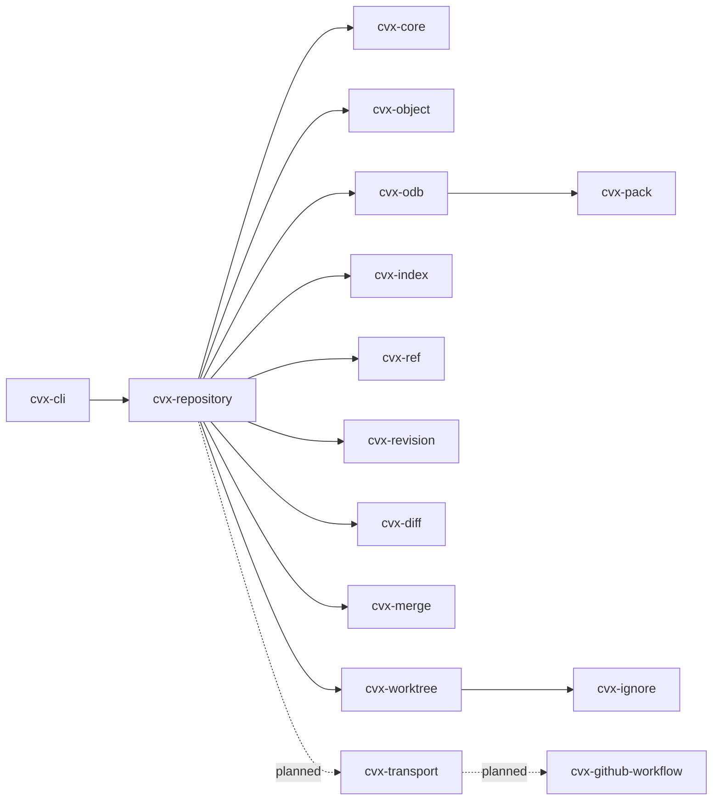

# CVX 🦀

**Own your history. Connect your code.**

[](https://github.com/marcosgabrielgomes110-collab/cvx/actions/workflows/ci.yml)
[](#license)
[](https://www.rust-lang.org/)

CVX (Code Version eXchange) is a Git-compatible version control system written
in Rust. It reads and writes the Git repository format, so existing history and
tooling keep working, but the engine does not shell out to the `git` executable.

> **Status: local transport alpha.** The local core, navigation, merge and
> local-path transport workflows are implemented. HTTPS, SSH and GitHub
> integration are not available yet. Commands are announced here as they become
> usable.

## What works today

```console
$ cvx init
$ cvx add .
$ cvx commit -m "feat: first commit"
$ cvx status
$ cvx log --oneline
$ cvx diff
$ cvx restore --staged file.rs
$ cvx checkout -- file.rs
$ cvx branch feature/auth
$ cvx switch feature/auth
$ cvx merge main
$ cvx tag -a v1.0.0 -m "first release"
$ cvx log --oneline --decorate
$ cvx clone ../other checkout
$ cvx fetch origin
$ cvx push origin main
```

Local paths and `file://` URLs are supported today; `https://` and `ssh://`
fail with an explicit unsupported-transport error until the network milestone
lands.

Implemented:

- Git-compatible `.cvx/` storage and direct `.git/` compatibility mode;
- loose objects and packfile reads, including delta chains;
- index versions 2 through 4 on input;
- refs, packed refs, detached HEAD and reflogs;
- `init`, `add`, `commit`, `status`, `log`, `diff`, `restore`, `checkout`,
  `branch`, `switch`, `merge` and `tag`;
- three-way merges, conflict markers, index stages 1/2/3 and merge commits with
  two parents;
- `merge --abort` and `merge --continue`;
- annotated and lightweight tags, plus `log --decorate`;
- rename detection in `status` and `diff`;
- pack writing and readable/writable pack indexes;
- object enumeration and commit/tree/tag reachability;
- `clone`, `fetch`, `push` and remotes over local paths and `file://`;
- safe worktree checkout with path, symlink and untracked-file protection;
- differential tests against the official Git binary.

Not implemented yet: HTTPS and SSH transports, credentials and keychain,
GitHub authentication and APIs, SHA-256 repositories, submodules, LFS, hooks,
commit signing, `.gitattributes` and CRLF normalization.

## Design decisions

- **Git-compatible storage.** CVX does not invent a new object format. A new
  repository stores the standard Git layout inside `.cvx/`.
- **CVX-branded control directory.** New repositories use `.cvx/`; existing
  Git repositories in `.git/` are opened directly in compatibility mode.
- **No runtime Git dependency.** The official Git binary is used only as a
  compatibility oracle in tests. Production code never invokes it.
- **Engine written in Rust.** Parsing, hashing, storage, index, refs, packs,
  diffing and commit traversal are implemented in this workspace, with
  primitive crates for SHA-1, zlib, text diffing and CLI parsing.
- **Loose writes, packed reads.** CVX writes loose objects and reads loose
  objects and version-2/3 packfiles.
- **SHA-1 first.** SHA-256 repositories are detected and rejected explicitly.
- **Unsupported means unsupported.** Features outside the current milestone fail
  with a clear error; they are never silently simulated.

## Architecture



Full diagrams for crate dependencies, repository discovery, the object model,
commit flow and future transports live in
[docs/architecture.md](docs/architecture.md).

## Quick start

```console
$ cargo build --workspace
$ ./target/debug/cvx init /tmp/demo
Initialized empty CVX repository in /tmp/demo/.cvx/
$ cd /tmp/demo
$ printf 'hello\n' > hello.txt
$ cvx add .
$ cvx commit -m "feat: first commit"
[main (root-commit) 1c2d3e4] feat: first commit

$ cvx log --oneline
1c2d3e4 feat: first commit
```

The same repository can be inspected with Git:

```console
$ git --git-dir=.cvx --work-tree=. status
$ git --git-dir=.cvx --work-tree=. fsck --strict
$ git --git-dir=.cvx --work-tree=. log
```

`.cvx/info/exclude` hides the control directory from Git's status.

To create a standard `.git/` repository instead:

```console
$ cvx init --storage git
```

Existing Git repositories are detected automatically and used in compatibility
mode, including repositories packed by `git gc`.

## Commands

| Command | Notes |
| --- | --- |
| `cvx init [DIR]` | `--initial-branch`, `--storage cvx\|git`, `--quiet` |
| `cvx clone <URL> [DIR]` | Local paths and `file://`; `--branch`, `--storage` |
| `cvx remote [list]` | `add <NAME> <URL>` |
| `cvx fetch [REMOTE]` | Updates `refs/remotes/*` and tags |
| `cvx push [REMOTE] [BRANCH]` | `-f/--force` for non-fast-forward updates |
| `cvx add <PATH>...` | `-A/--all`, `-u/--update`, `-f/--force` |
| `cvx commit -m <MSG>` | Repeat `-m` for paragraphs; `--allow-empty` |
| `cvx status` | `--porcelain`, `--short`, `--untracked-files=no\|normal\|all` |
| `cvx log [REVISION]` | `--oneline`, `-n/--max-count`, `--decorate` |
| `cvx diff [REV...] [-- PATH...]` | `--cached`, `--stat`, `-U<n>`, rename detection |
| `cvx restore <PATH>...` | `--staged`, `--worktree`, `--source`, `--force` |
| `cvx checkout -- <PATH>...` | Restore worktree files from the index |
| `cvx branch [NAME] [START]` | `--list`, `-d`, `-D` |
| `cvx switch <BRANCH>` | `-c`, `--detach`, `--force` |
| `cvx merge <REVISION>` | `-m`, `--continue`, `--abort` |
| `cvx tag [NAME] [TARGET]` | `-l/--list`, `-a/--annotate`, `-m`, `-f/--force` |
| `cvx version` | Engine and repository format information |

## Benchmarks

Illustrative reporting format — **not measured CVX results**:

```markdown
# Read benchmark

**Environment:** Arch Linux x86_64
**Language:** Rust stable, release profile
**Data:** 1,000,000 records

| Operation | Time |
|---|---:|
| Sequential read | 120 ms |
| Index lookup | 3 ms |

> Values are illustrative. Run the benchmarks on your machine.
```

The benchmark policy and planned scenarios are in
[docs/benchmarks.md](docs/benchmarks.md).

## Documentation

- [Documentation index](docs/README.md)
- [Architecture and Mermaid diagrams](docs/architecture.md)
- [Workflows and sequence diagrams](docs/workflows.md)
- [Compatibility matrix](docs/compatibility.md)
- [Roadmap](docs/roadmap.md)
- [Repository layout](docs/spec/repository-layout.md)
- [Detailed design notes](docs/architecture/overview.md)
- [Benchmarks](docs/benchmarks.md)
- [Changelog](CHANGELOG.md)
- [Contributing](CONTRIBUTING.md)
- [Security policy](SECURITY.md)

## Build and test

```console
$ cargo build --workspace
$ cargo test --workspace
$ cargo fmt --all --check
$ cargo clippy --workspace --all-targets -- -D warnings
$ cargo doc --workspace --no-deps
```

The differential tests require a `git` binary in `PATH`; the CVX binary itself
does not.

## Roadmap

| Phase | Scope | Status |
| --- | --- | --- |
| 0 | Specification, architecture, compatibility contract | Complete |
| 1 | Local core: objects, index, refs, commits, status, log | Complete |
| 2A | Diff, restore/checkout, branches, switch | Complete |
| 2B | Merge, conflicts, tags creation, rename detection | Complete |
| 3 | Pack writing, clone/fetch/push, SSH/HTTPS, credentials | In progress — local transport complete |
| 4 | GitHub API, auth, pull requests, issues, releases | Planned |
| 5 | Fuzzing, crash recovery, benchmarks, release hardening | Ongoing |

## Contributing

Contributions are welcome. Read [CONTRIBUTING.md](CONTRIBUTING.md) before opening
a large pull request. Security issues should follow [SECURITY.md](SECURITY.md),
not public issues.

## License

Licensed under either of

- Apache License, Version 2.0 ([LICENSE-APACHE](LICENSE-APACHE))
- MIT license ([LICENSE-MIT](LICENSE-MIT))

at your option.
