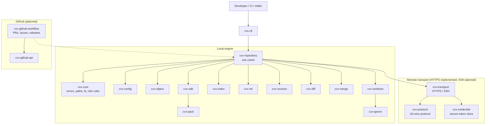
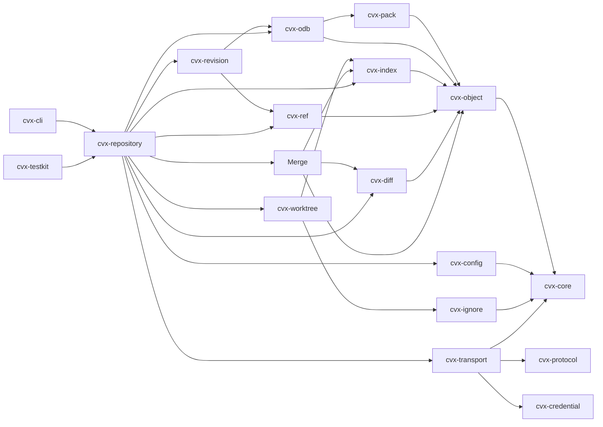
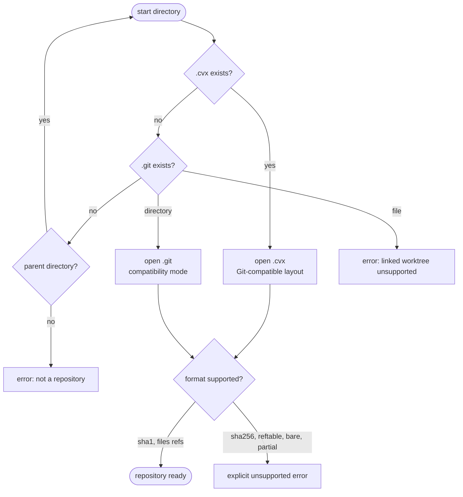
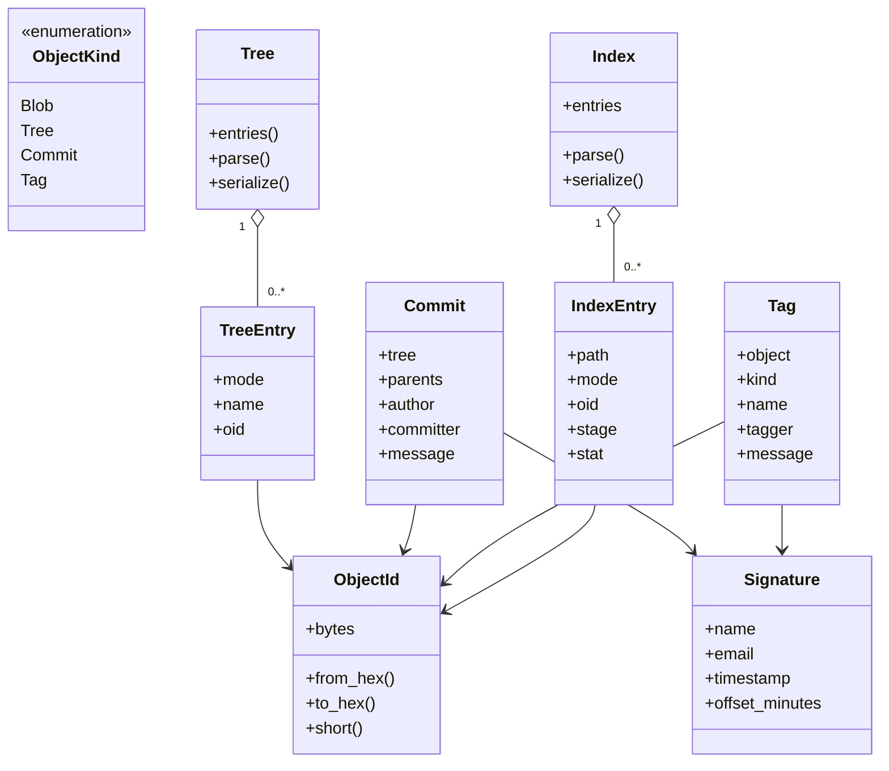
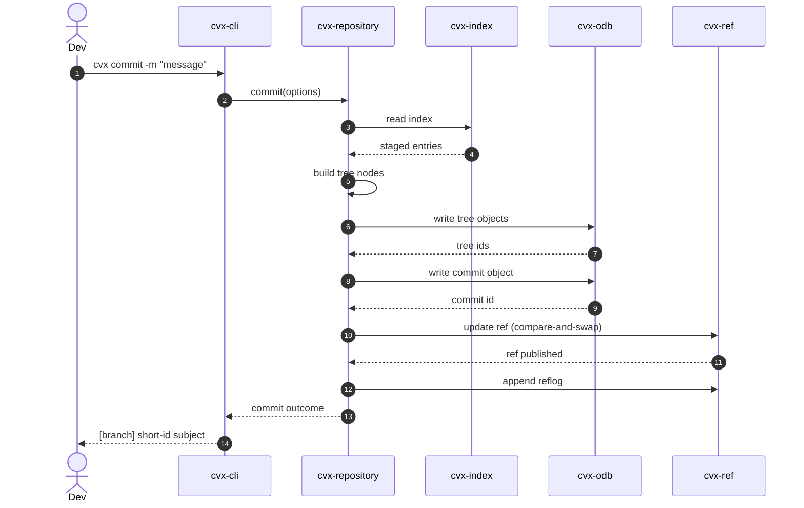
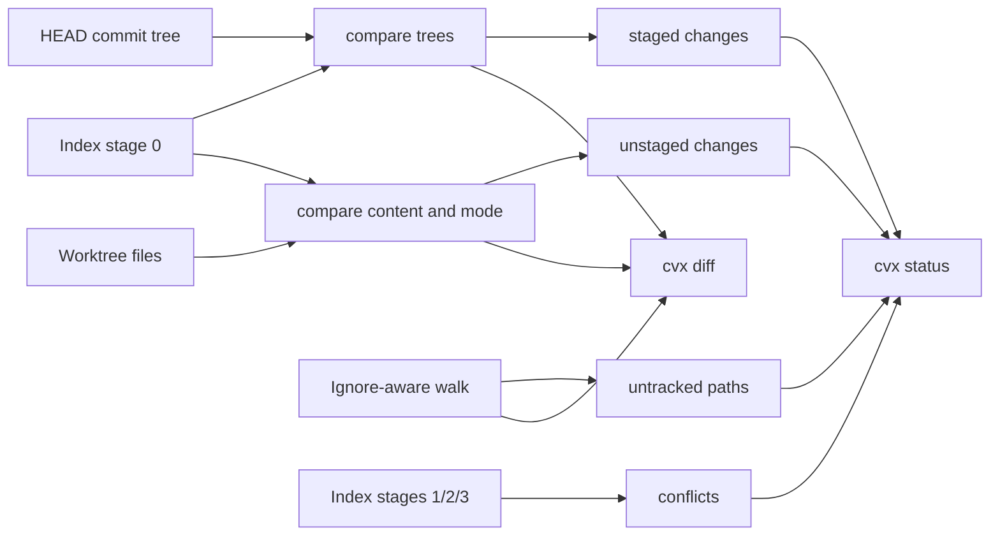
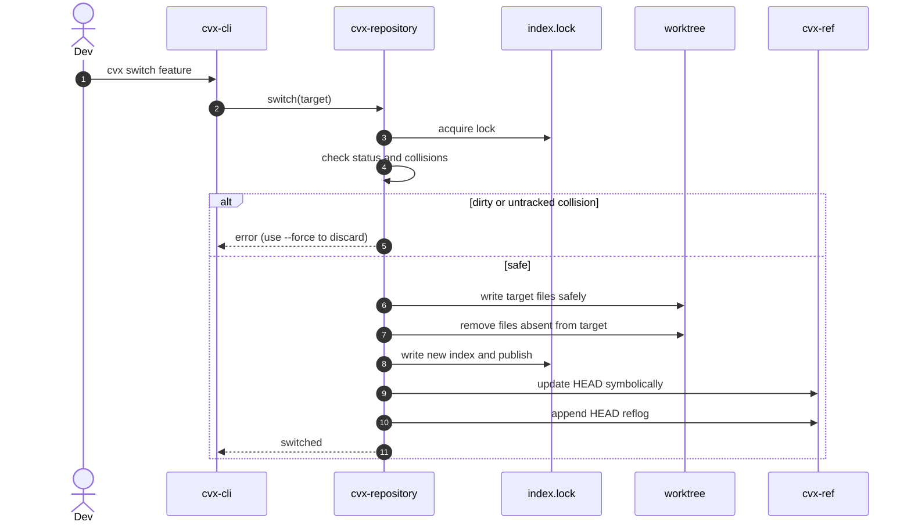
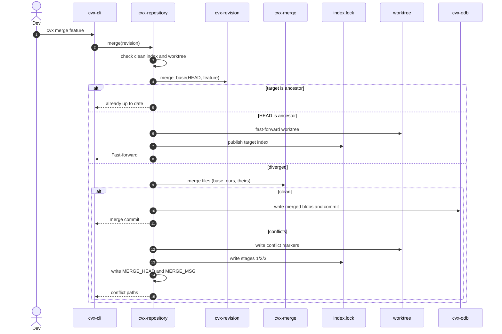
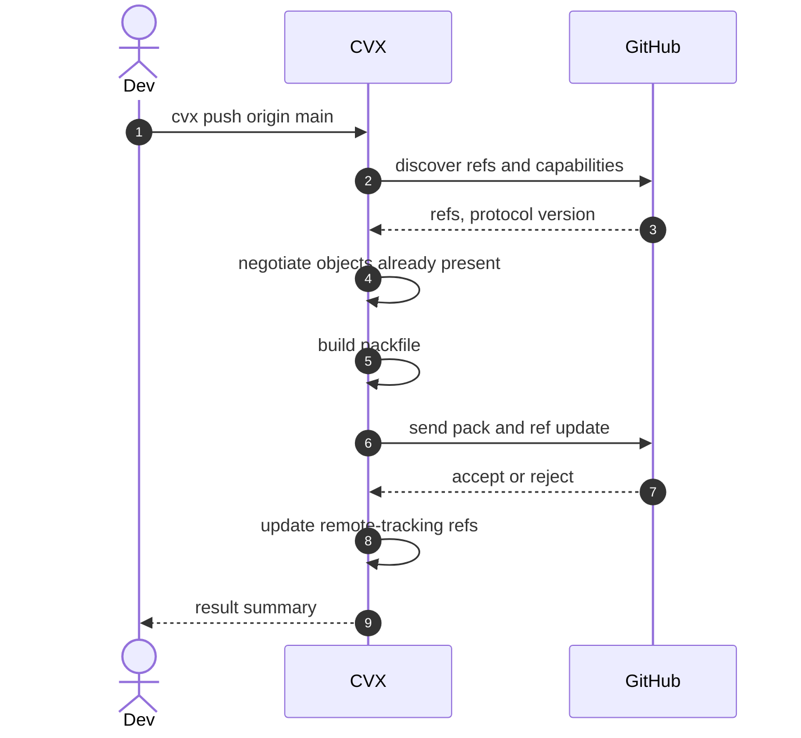

# CVX architecture

> All diagrams below are written in [Mermaid](https://mermaid.js.org/) and render
> directly on GitHub, in Markdown previews with Mermaid support, and at
> [mermaid.live](https://mermaid.live/). They are versioned with the code.

## System overview

CVX is a Git-compatible engine with a Rust CLI, a local object store, an
optional network layer, and GitHub as the first collaboration platform.

Solid arrows are implemented dependencies. Dotted arrows are planned
integration points.

## Crate dependency graph

Dependencies point from higher-level orchestration toward lower-level formats.
`cvx-core` has no knowledge of Git objects, refs, packs or GitHub.

## Repository discovery

Discovery walks upward until it finds `.cvx/` or `.git/`. CVX prefers `.cvx/`
when both exist and rejects formats that are not implemented.

## Object model

## Commit flow

`cvx commit` writes immutable objects first, then publishes the branch
reference atomically. A failure before the ref update leaves unreachable
objects, never a partially published commit.

## Status and diff pipeline

## Checkout and branch switching

## Merge flow

`cvx merge` compares the merge base with both tips. Non-overlapping changes are
combined, while conflicting paths receive markers in the worktree and stages
1/2/3 in the index. A clean merge creates a two-parent commit; conflicts leave
`MERGE_HEAD` and `MERGE_MSG` behind for `--continue` or `--abort`.

## Future remote flow

This diagram documents intended behavior, not current support.

## Where to go next

- [Compatibility matrix](compatibility.md)
- [Detailed design notes](architecture/overview.md)
- [Repository layout](spec/repository-layout.md)
- [Workflows](workflows.md)
- [Benchmarks](benchmarks.md)
