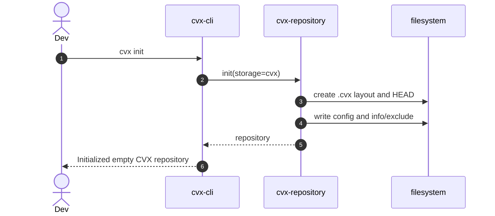
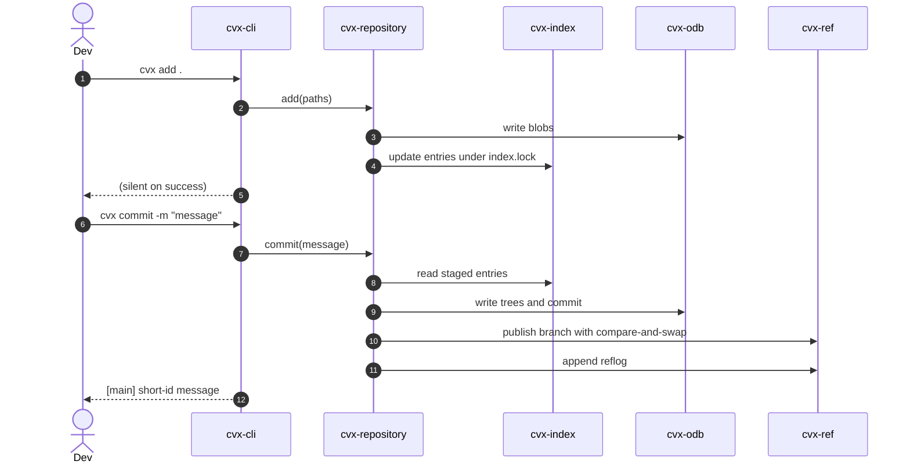
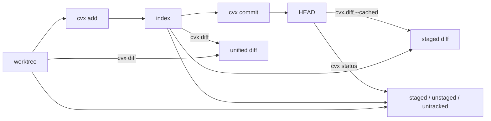
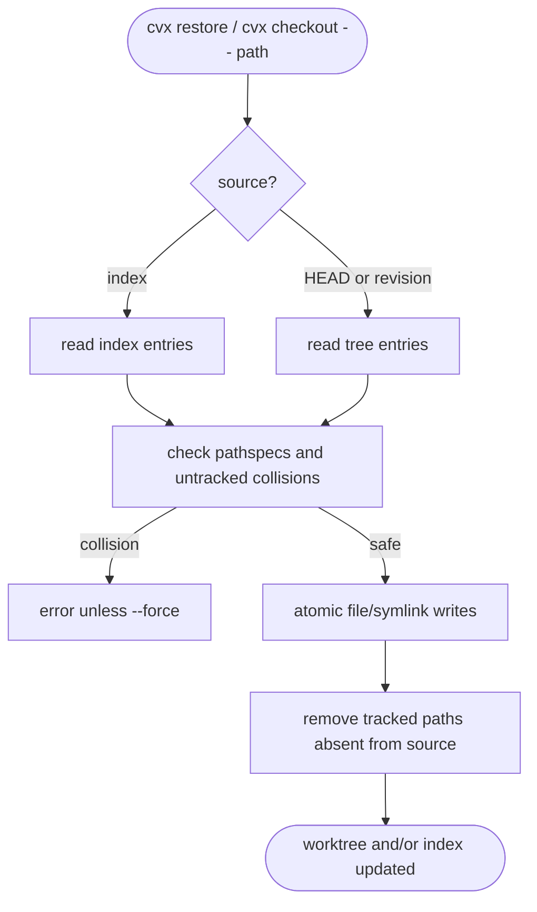
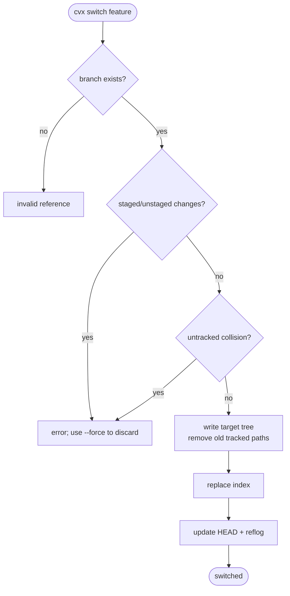
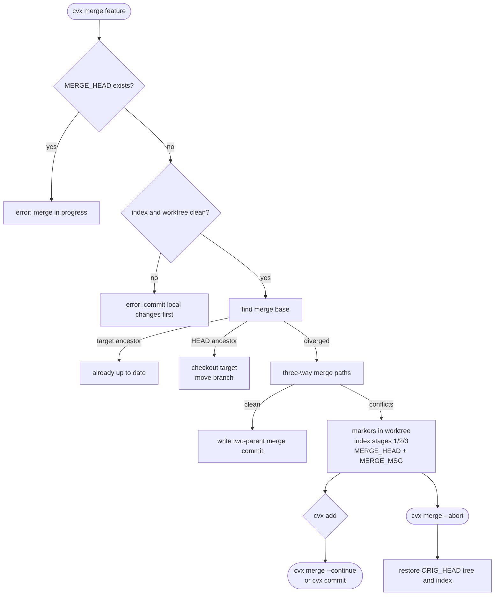
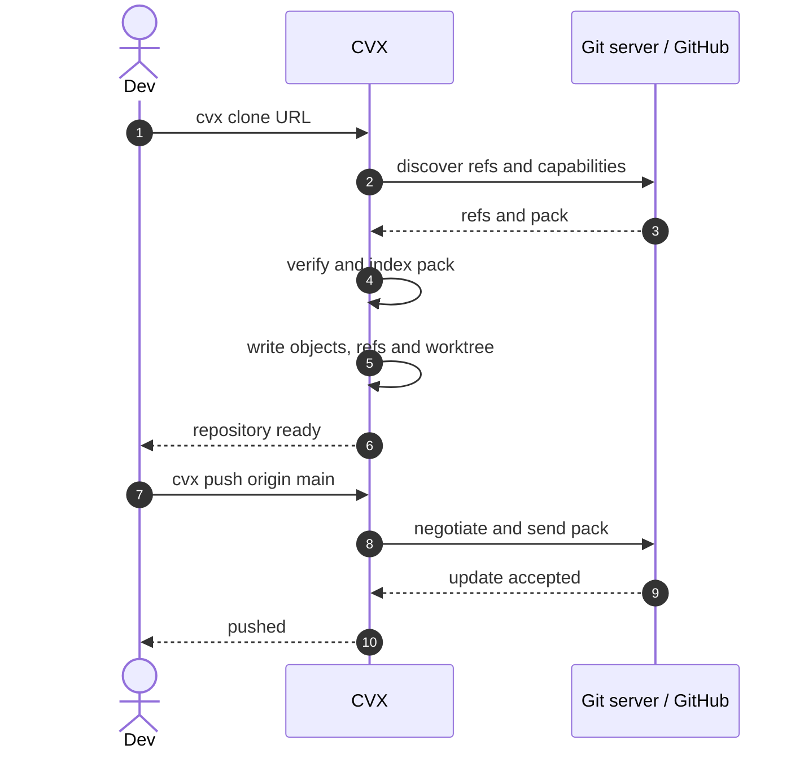

# CVX workflows

These diagrams describe the implemented local workflow. Remote and GitHub
flows are marked as planned.

## Initialize a repository

## Stage and commit

## Inspect changes

## Restore safely

## Branch and switch

## Merge and resolve conflicts

## Planned clone/push

